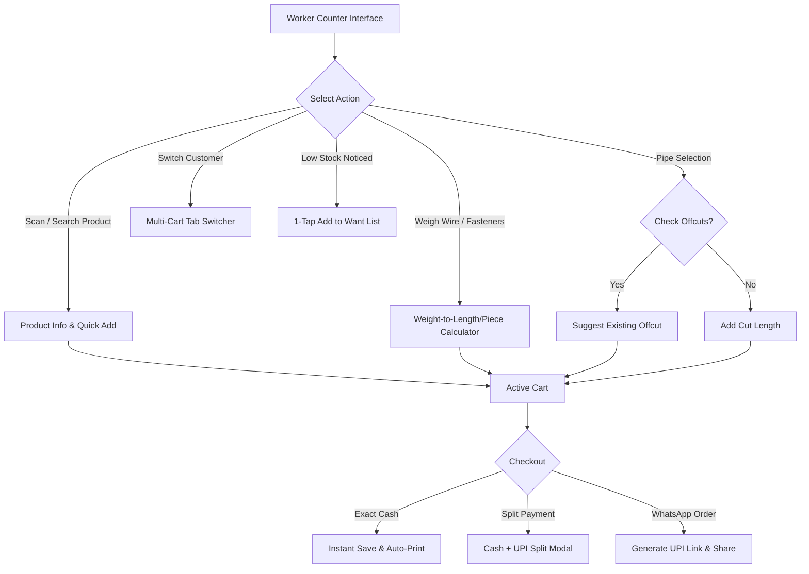

# HardwareShopPOS: Advanced Retail Intelligence Architect Blueprint
**Specification Document Version**: 1.0.0  
**Target Application**: `HardwareShopPOS` (`com.hardwareshop.pos`)  
**Architecture Core**: Android, Kotlin, Jetpack Compose, Room SQLite, Hilt DI, Coroutines/Flow, WorkManager, Firebase Firestore Sync V2  

---

## 1. Existing Project Architecture Observations

After reviewing the source files of `HardwareShopPOS`, the existing system is built on a local-first Room database architecture with a layered design:

1. **Database Layer (`com.hardwareshop.pos.data.local`)**:
   * **[AppDatabase.kt](file:///C:/Users/mohammed%20saud/Documents/Codex/HardwareShopPOS/app/src/main/java/com/hardwareshop/pos/data/local/database/AppDatabase.kt)**: Manages SQLite database version 10 with Write-Ahead Logging (WAL) mode enabled.
   * **[Entities.kt](file:///C:/Users/mohammed%20saud/Documents/Codex/HardwareShopPOS/app/src/main/java/com/hardwareshop/pos/data/local/entity/Entities.kt)**: Defines primary entities (`CategoryEntity`, `ProductTypeEntity`, `ProductEntity`, `CustomerEntity`, `WorkerEntity`, `BillEntity`, `BillItemEntity`, `PaymentEntity`, `CreditTransactionEntity`, `StockAdjustmentEntity`, `SupplierEntity`, `PurchaseBillEntity`, `PurchaseBillItemEntity`, `DayClosingEntity`, `AuditLogEntity`, `SettingsEntity`).
   * **[Daos.kt](file:///C:/Users/mohammed%20saud/Documents/Codex/HardwareShopPOS/app/src/main/java/com/hardwareshop/pos/data/local/dao/Daos.kt)**: Reactive data access objects using Kotlin `Flow` and `suspend` functions.

2. **Repository & Domain Layer (`com.hardwareshop.pos.data.repository`)**:
   * **[Repositories.kt](file:///C:/Users/mohammed%20saud/Documents/Codex/HardwareShopPOS/app/src/main/java/com/hardwareshop/pos/data/repository/Repositories.kt)**: `ProductRepository`, `BillingRepository`, `CustomerRepository`, `SettingsRepository`, `AuditRepository`, and `TradeRepository`.
   * **[BillingAndStockRepositories.kt](file:///C:/Users/mohammed%20saud/Documents/Codex/HardwareShopPOS/app/src/main/java/com/hardwareshop/pos/data/repository/BillingAndStockRepositories.kt)**: Specialized repositories for POS counter operations.

3. **Presentation Layer (`com.hardwareshop.pos.presentation`)**:
   * **Jetpack Compose UI**: [WorkerScreens.kt](file:///C:/Users/mohammed%20saud/Documents/Codex/HardwareShopPOS/app/src/main/java/com/hardwareshop/pos/presentation/worker/billing/WorkerScreens.kt), [OwnerScreens.kt](file:///C:/Users/mohammed%20saud/Documents/Codex/HardwareShopPOS/app/src/main/java/com/hardwareshop/pos/presentation/owner/OwnerScreens.kt), [ProductScreens.kt](file:///C:/Users/mohammed%20saud/Documents/Codex/HardwareShopPOS/app/src/main/java/com/hardwareshop/pos/presentation/owner/products/ProductScreens.kt).
   * **ViewModels**: [BillingViewModel.kt](file:///C:/Users/mohammed%20saud/Documents/Codex/HardwareShopPOS/app/src/main/java/com/hardwareshop/pos/presentation/worker/billing/BillingViewModel.kt) (graph-scoped in `AppNavGraph.kt`), `ProductSelectionViewModel`.

4. **Synchronization Layer (`com.hardwareshop.pos.data.sync`)**:
   * **[SyncJournalSchema.kt](file:///C:/Users/mohammed%20saud/Documents/Codex/HardwareShopPOS/app/src/main/java/com/hardwareshop/pos/data/sync/SyncJournalSchema.kt)**: SQLite triggers intercept Room mutations and log change revisions into `sync_dirty` without network blocking.
   * **[SyncEngine.kt](file:///C:/Users/mohammed%20saud/Documents/Codex/HardwareShopPOS/app/src/main/java/com/hardwareshop/pos/data/sync/SyncEngine.kt)**: Resumable outbox/inbox processing for Firebase Firestore V2 protocol.

---

## 2. Feature-by-Feature Detailed Specifications

### Feature 1: Wire/Cable Weight-to-Length Conversion
* **Problem**: Electrical wires, copper coils, and winding wire rolls are often stored and weighed on physical scales, but customers buy them by length (meters or feet).
* **Technical Design**:
  * Store calibrated `calibratedGramsPerMeter` in `ProductEntity` (or a dedicated `wire_calibrations` table).
  * Worker inputs measured **Gross Weight (grams)**.
  * System subtracts **Tare Weight / Spool Weight (grams)** to calculate **Net Conductor Weight (grams)**.
  * **Formula**:
    $$\text{Length (Meters)} = \frac{\text{Gross Weight (g)} - \text{Tare Weight (g)}}{\text{Grams Per Meter (g/m)}}$$
    $$\text{Length (Feet)} = \text{Length (Meters)} \times 3.28084$$
* **UI & Workflow**:
  * In the product quantity dialog, if `product.unit` is `"Meter"` or `"Foot"`, display a **"⚖️ Weigh Cable"** toggle.
  * Inputs: Gross Weight (g), Tare Spool Selection (e.g. *Plastic Spool 120g*, *Wooden Drum 450g*, *Bare/No Spool*).
  * Output Display: *"Estimated Length: 24.5 Meters (80.4 Feet) [Estimated]"*.
  * Label: Must explicitly display **"Estimated"** on receipt line items when calculated via weight.

### Feature 2: Fastener Weight-to-Piece Conversion
* **Problem**: Screws, nuts, bolts, washers, and nails are stocked in bulk boxes/sacks and sold by estimated piece count or weight.
* **Technical Design**:
  * Add `averageWeightPerPieceGrams` (Double) and `defaultTareGrams` (Double) to product metadata.
  * **Sample Calibration Assistant**: Worker weighs a known sample count (e.g., 10 screws = 32 grams $\rightarrow$ $3.2\text{ g/piece}$).
  * **Formula**:
    $$\text{Estimated Pieces} = \text{Math.round}\left(\frac{\text{Gross Weight (g)} - \text{Tare Weight (g)}}{\text{Average Weight Per Piece (g)}}\right)$$
* **UI & Workflow**:
  * Tapping a Fastener product opens a dual input modal: **"By Piece Count"** or **"By Weight (g/kg)"**.
  * Shows calculated piece count with rounding indicator ($\pm 2\%$ variance note).

### Feature 3: Smart Pipe Offcut Assistant
* **Problem**: Cutting 20ft pipes leaves short offcuts (e.g., 3.5ft, 5ft) that clutter the shop floor.
* **Technical Design**:
  * Integrates directly with existing [`PipeOffcutRepository.kt`](file:///C:/Users/mohammed%20saud/Documents/Codex/HardwareShopPOS/app/src/main/java/com/hardwareshop/pos/data/repository/PipeOffcutRepository.kt) and [`PipeCutPlanner.kt`](file:///C:/Users/mohammed%20saud/Documents/Codex/HardwareShopPOS/app/src/main/java/com/hardwareshop/pos/util/PipeCutPlanner.kt).
  * When a pipe or fitting is selected for billing, query Room:
    ```sql
    SELECT * FROM pipe_offcuts 
    WHERE productId = :productId AND lengthFeet >= :requestedFeet AND status = 'AVAILABLE'
    ORDER BY lengthFeet ASC LIMIT 1;
    ```
  * Suggests offcut before cutting a new 20ft pipe.
  * Billing offcut records status change to `SOLD` linked to `bill_id` without creating duplicate product stock deductions.

### Feature 4: Local Slang and Regional Product Search
* **Problem**: Counter workers and local plumbers search using regional terms (*"Aari Patta"*, *"Dhaga Tape"*, *"Stop Cock"*, *"Pech"*).
* **Technical Design**:
  * Expand `ProductEntity.searchAliases` and create a dedicated `product_aliases` table linked to `productId`.
  * Owner UI in [ProductScreens.kt](file:///C:/Users/mohammed%20saud/Documents/Codex/HardwareShopPOS/app/src/main/java/com/hardwareshop/pos/presentation/owner/products/ProductScreens.kt) allows adding multiple comma-separated regional aliases per product.
  * Intercepted in [`ProductSearch.kt`](file:///C:/Users/mohammed%20saud/Documents/Codex/HardwareShopPOS/app/src/main/java/com/hardwareshop/pos/util/ProductSearch.kt) token matcher: alias tokens receive equal search score weighting to product name tokens.

### Feature 5: One-Tap Want List / Kharidi List
* **Problem**: Staff notice low shelf stock during billing and need a 1-second way to log a reorder note for the owner.
* **Technical Design**:
  * Create `WantListItemEntity` table (`id`, `productId`, `productName`, `requestedQty`, `unit`, `notes`, `priority`, `requestedByWorkerName`, `status`, `createdAt`).
  * Add a **"📝 Add to Want List"** action on every product card in [WorkerScreens.kt](file:///C:/Users/mohammed%20saud/Documents/Codex/HardwareShopPOS/app/src/main/java/com/hardwareshop/pos/presentation/worker/billing/WorkerScreens.kt).
  * **Strict Constraint**: Want List items are notes only; they do **NOT** modify inventory or generate purchase bills automatically.

### Feature 6: Digital WhatsApp Shop Catalog (Free-First Workflow)
* **Problem**: Customers send order requests via WhatsApp; workers need to convert them into bills without re-typing.
* **Technical Design**:
  * **Zero-Paid API Approach**: Uses public web catalog URL or WhatsApp shareable structured order message.
  * **Import Flow**: Customer sends text or JSON order summary to shop's WhatsApp. Worker uses "Import WhatsApp Order" in `BillingViewModel`, which parses line items, maps product names to local catalog IDs, and loads them into a **Pending Order Draft**.
  * Worker reviews prices and availability before converting to a final bill.

### Feature 7: Billing Workflow Improvements
* **Split Payments**:
  * Update checkout state to support `PaymentSplit(cashPaisa: Long, upiPaisa: Long)`.
  * Validation: `cashPaisa + upiPaisa == totalPaisa`.
  * Generates two corresponding payment rows in `payments` table for the bill.
* **Multi-Customer Cart Switching**:
  * Expand [`ParkedBillControls.kt`](file:///C:/Users/mohammed%20saud/Documents/Codex/HardwareShopPOS/app/src/main/java/com/hardwareshop/pos/presentation/worker/billing/ParkedBillControls.kt) into a tabbed `MultiCartHolder` state (`Cart 1`, `Cart 2`, `Cart 3`).
  * Switching tabs preserves all cart items, discounts, and customer associations in memory without saving bills to DB or deducting stock.
* **Color-Coded Category Tabs**:
  * Assign distinct, high-contrast, accessible Material 3 color tokens to `CategoryEntity` (`colorHex`).
* **Swipe-to-Edit Cart Items**:
  * Wrap cart items in Compose `SwipeToDismissBox` (Swipe Right = +1 Qty, Swipe Left = Remove). Provide explicit `+` / `-` / `Delete` icon buttons as accessible alternatives.

### Feature 8: Bill Merging From Billing History
* **Problem**: A contractor buys hardware in 3 separate visits on the same day and requests a single combined bill at the end of the day.
* **Technical Design**:
  * In [BillHistoryScreen](file:///C:/Users/mohammed%20saud/Documents/Codex/HardwareShopPOS/app/src/main/java/com/hardwareshop/pos/presentation/owner/misc/RemainingScreens.kt), enable multi-select checkbox mode for active bills belonging to the same customer.
  * **Legal & Tax Treatment**:
    * Merging generates a **"Consolidated Statement of Bills"** (or a cancellation + replacement tax invoice if all source bills are cancelled within the same tax period).
    * Original bills are retained in audit history. Stock is **NOT** re-deducted (source bills already deducted stock).

### Feature 9: Accountant / CA PDF Exports
* **Problem**: Chartered Accountants require structured tax reports for monthly GST filing (GSTR-1 / GSTR-3B).
* **Technical Design**:
  * Create `AccountantReportGenerator.kt` to compile data for a selected date range:
    1. **B2B Sales Register** (with customer GSTINs).
    2. **B2C Sales Register** (Taxable value, CGST, SGST, IGST breakdown).
    3. **Tax-Rate-Wise Summary** (0%, 5%, 12%, 18%, 28% slabs).
    4. **Payment Mode Reconciliation** (Cash, UPI, Credit).
  * Exports both **Professional PDF Report** and **Structured CSV/XLSX File**.

### Feature 10: WhatsApp Receipts and Udhar Reminders
* **Technical Design**:
  * Uses Android's native `Intent.ACTION_SEND` / `Intent.ACTION_VIEW` targeting `com.whatsapp` or `com.whatsapp.w4b` (WhatsApp Business).
  * **User-Initiated Flow**: Generates receipt PDF in local cache, formats structured pre-filled text with UPI payment link, and opens WhatsApp chat picker.
  * **Udhar Reminder**: Pre-formats balance summary: *"Dear [Name], your pending balance at [Shop Name] is ₹[Amount]. Tap to pay via UPI: [UPI_Link]"*.

### Feature 11: Custom Receipt Tagline
* **Technical Design**:
  * Add `receipt_tagline` key to `settings` table in Room.
  * Editable in [SettingsScreen](file:///C:/Users/mohammed%20saud/Documents/Codex/HardwareShopPOS/app/src/main/java/com/hardwareshop/pos/presentation/owner/misc/RemainingScreens.kt) with a 150-character limit validator.
  * Rendered by [`ReceiptBuilder.kt`](file:///C:/Users/mohammed%20saud/Documents/Codex/HardwareShopPOS/app/src/main/java/com/hardwareshop/pos/util/ReceiptBuilder.kt) at the bottom of 58mm / 80mm thermal receipts.

---

## 3. Recommended User Workflows



---

## 4. Mathematical Formulas & Verification Examples

1. **Cable Length from Weight**:
   $$\text{Length (m)} = \frac{1250\text{ g (Gross)} - 150\text{ g (Spool)}}{22.5\text{ g/m (Calibrated)}} = 48.88\text{ meters}$$
   $$\text{Length (ft)} = 48.88 \times 3.28084 = 160.36\text{ feet}$$

2. **Fastener Piece Count**:
   $$\text{Pieces} = \text{Math.round}\left(\frac{500\text{ g} - 20\text{ g (Bag)}}{3.2\text{ g/piece}}\right) = \text{Math.round}(150.0) = 150\text{ pieces}$$

3. **Split Payment Verification**:
   $$\text{Total Bill} = \text{₹2,450.00} \implies \text{Cash Paisa} (100000) + \text{UPI Paisa} (145000) = 245000\text{ Paisa}$$

---

## 5. Proposed Room Entities and Database Schema Changes

To support these features without breaking existing migrations, the following entities and columns are added in **Migration 10 to 11**:

```kotlin
// 1. Want List Table
@Entity(tableName = "want_list")
data class WantListItemEntity(
    @PrimaryKey(autoGenerate = true) val id: Long = 0,
    val productId: Long?,
    val productName: String,
    val requestedQuantity: Double,
    val unit: String,
    val priority: String, // "NORMAL", "URGENT"
    val notes: String,
    val requestedByWorkerName: String,
    val isPurchased: Boolean = false,
    val createdAt: Long = System.currentTimeMillis()
)

// 2. Product Slang Aliases Table
@Entity(
    tableName = "product_aliases",
    foreignKeys = [
        ForeignKey(
            entity = ProductEntity::class,
            parentColumns = ["id"],
            childColumns = ["productId"],
            onDelete = ForeignKey.CASCADE
        )
    ],
    indices = [Index("productId")]
)
data class ProductAliasEntity(
    @PrimaryKey(autoGenerate = true) val id: Long = 0,
    val productId: Long,
    val aliasText: String
)

// 3. New columns added to ProductEntity via Migration 10To11:
// ALTER TABLE products ADD COLUMN gramsPerMeter REAL DEFAULT 0.0;
// ALTER TABLE products ADD COLUMN averageWeightPerPieceGrams REAL DEFAULT 0.0;
```

---

## 6. Proposed Compose Screen Changes

1. **`WorkerScreens.kt`**:
   * Add `TopScrollableTabRow` for Color-Coded Categories.
   * Add Floating Multi-Cart Switcher (`Cart 1`, `Cart 2`, `Cart 3`).
   * Add **"⚖️ Weigh Cable/Fastener"** modal button inside `BillingQuantityKeypad`.

2. **`RemainingScreens.kt`**:
   * **`AccountantReportScreen`**: Date-range picker, summary cards, and **"Generate CA PDF"** / **"Export Excel"** buttons.
   * **`WantListScreen`**: Filterable list of reorder notes with **"Mark Purchased"** action.

3. **`SettingsScreen`**:
   * Add **"Receipt Tagline Header/Footer"** text editor with live thermal print preview component.

---

## 7. Synchronization Behavior (Firebase & Offline Security)

1. **Offline First**: All new entities (`WantListItemEntity`, `ProductAliasEntity`, Split Payments) operate 100% offline in Room SQLite first.
2. **Sync Protocol Mapping**:
   * `want_list`: Mapped to `SyncProtocol.Scope.PRIVATE` (Owner only).
   * `product_aliases`: Mapped to `SyncProtocol.Scope.PUBLIC` (Synced to all shop phones).
   * `split_payments`: Reflected inside standard `payments` table sync envelope.

---

## 8. Priority Implementation Order for Codex

1. **Task 1: Database Migration 10To11** (Add `WantListItemEntity`, `ProductAliasEntity`, and cable/fastener fields to `ProductEntity`).
2. **Task 2: Billing Workflow Enhancements** (Split Payments, Multi-Cart Switching, Color-Coded Category Tabs).
3. **Task 3: Cable & Fastener Weight Calculators** (In-memory math & UI modals).
4. **Task 4: Want List / Kharidi List Module** (DAO, Repository, UI).
5. **Task 5: Accountant CA PDF Generator** (PDF rendering engine & CSV exporter).
6. **Task 6: WhatsApp Native Integration & Custom Tagline**.

---

## 9. Acceptance Criteria for Codex

1. **Zero Data Loss**: Existing database records (bills, products, customers, stock) must remain intact after Migration 10To11.
2. **Performance**: All calculation modals (cable length, fastener count) must compute in $< 1\text{ ms}$ on main thread.
3. **Split Payments**: `cashPaisa + upiPaisa` must strictly equal `totalPaisa` before bill commit.
4. **Multi-Cart Switching**: Switching tabs must never execute a Room database insert or alter product stock until "Complete Bill" is explicitly pressed.
5. **Offline Operation**: Every single feature must function without an active internet connection.

