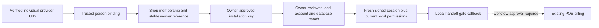

<!-- PHASE4J_CURRENT -->
## Phase 4J final local gate — 22 October 2026

**83.5% unchanged (+0%); Phase 5 entry BLOCKED.**

- ✅ Fresh minified/shrunk release build and actual APK hash/static DEX guards pass after AGP 8.6.1 compiler repair.
- ✅ Fresh debug/test build and 312/312 JVM tests, 0 failures/errors/skips.
- ✅ Archive scaling 2/2: 1,024 receipts need 1,026 source reads versus 50,689; 0 verification writes; no schema/index/deletion change.
- ✅ Local website build/artifact scan and 10/10 browser regressions (9 main+1 delayed-hours), 7 viewports, 0 console errors/external requests.
- ❌ Final backend:104 passed, 2 failed, 1 platform skip;106 executed/107 defined. Concurrent ordering and signed-read transport still fail.
- ❌ Native setup blocked before JUnit at 181.1 s; 0 native tests executed. Historical 15 s app/keyboard acceptance remains open.
- ⬜ Focused 200 sync/full capacity gated; no new sustained 500/day, 30/60/90-day or provider-capacity credit. Historical 90,833-write busy day leaves only 9,167 before unknowns.
- ✅ Final preservation audit: 9,585 historical evidence files unchanged; 0 unexpected historical changes. Billing/stock, Room 11, Backup 8, pipes, printing and FCMsource protected.

See [Phase 4J final results](WEBSITE_PHASE4J_RESULTS.md) for exact files, commands, artifacts, failures, cost limits and required approvals. No production connection, deployment, paid activation, real enrollment, live data or Phase 5 execution. Historical sections below remain historical.
<!-- END_PHASE4J_CURRENT -->

# Local authentication and device protocol — through Phase 4H

## Phase 4H local lifecycle and production trust boundary

The main DEBUG adapter now implements installation-key proofs, a durable per-operation journal, current server session/epoch checks, staged dual-key rotation, reinstall/key mismatch denial and a restore quarantine. Hilt does not fall back to the legacy bearer fixture when pairing, rotation, uncertainty or quarantine metadata remains. Orders repository operations intersect server installation authority with the current active local worker and recheck session continuity after I/O. Native integrated and separate-process recovery acceptance is recorded in WEBSITE_PHASE4H_RESULTS.md; implementation alone earns no test or production-authentication credit.

The shared POS cannot approve devices through this adapter: device administration routes are denied independently of a local OWNER label. The existing owner/worker login, default Firebase session and offline billing remain unchanged. Historical individual-worker cloud adapters below are regression fixtures and are not the Version 1 login architecture.

A production bootstrap ceremony still requires explicit owner approval and a genuinely independent operator. The proprietor must establish that operator through an already trusted contact or in-person channel; neither the customer website, shared Firebase UID, local role label nor a self-entered phone number establishes ownership. The operator records the verified shop identity and proprietor approval, checks the installation's public fingerprint with the proprietor through a second agreed channel, and pins the shop/root/authority epoch through a protected administrative channel. Only then may a five-minute, single-use approval bind the exact shop, key fingerprint, device UUID, database epoch and reviewed capabilities. The installation must prove possession; a screenshot or copied approval alone is insufficient. The synthetic Node provisioner demonstrates cryptographic binding only, not this human trust ceremony.

Root private-key custody, two independently controlled encrypted recovery copies, authorized recovery operators, revocation/epoch procedures and proprietor contact recovery need separate approval. Losing a sole owner's device does not allow public self-approval. Recovery requires operator/proprietor review; an old archive cannot reactivate authority. For any sticky claim that could have been billed offline, reconcile the original device's local bill, payment and stock evidence with the server bill identity before any owner-reviewed resolution. Never automatically issue a replacement claim or bill. The old Phase 4G claims, six uncertain claims in the failed Phase 4H 500 cohort and two in its failed independent 1,000-order stress cohort remain untouched.

Production bootstrap, privileged owner administration, real enrollment and the real recovery/custody process remain **BLOCKED**, not implemented production features. No real root or shop credential was provisioned.

## Phase 4G Version 1 local shop-device adapter — 20 October 2026

`PAIRING_LOCAL` is an isolated prototype, not enabled production authentication. It preserves existing POS owner/worker login and authenticates an installation, not an individual worker. A Node-only synthetic administrator pins a public root, freshness and shop epoch server-side and privately provisions a five-minute, single-use grant bound to shop, installation public-key fingerprint, device UUID, database epoch and capabilities. First-owner redemption also requires the root signature and key possession. There is no public grant-creation/bootstrap endpoint. Owner-approved worker grants are rechecked against the current active owner at atomic redemption.

The real trust source must be an operator independently authorized by the actual shop proprietor through verified ownership/contact and a fingerprint ceremony. That operator controls root custody, approval evidence, recovery verification and epoch/revocation changes. No such real authority has been demonstrated; production bootstrap remains blocked. Sole-owner loss needs administrator review, not self-approval or automatic claim transfer. Existing shared Firebase UID/local OWNER labels grant no cloud authority.

The synthetic OWNER key represents an independently controlled owner installation. It is installation-wide authority, not proof of the person currently using a shared POS. A local worker session on an owner-paired installation must not become device administrator merely because the app can access that key. Before production wiring, approvals need an accepted independent owner/operator channel or an approved owner-reauthenticated privileged signing ceremony; a mutable local role check is insufficient. This owner-key use boundary is **not implemented/accepted** by the local adapter. The emulator protocol test uses two separate test aliases as synthetic installation identities; it is not a two-physical-device or shared-owner-terminal acceptance test. Global fingerprint uniqueness proves one key/shop binding, not hardware attestation.

Android-compatible P-256 proofs bind method, canonical full URL, exact body hash, installation/database epoch, timestamp, fresh nonce and stable operation ID. Current shop authority, active device, capabilities/expiry and signatures are checked online. Mutations atomically recheck authority/device version and consume nonce with the action. Exact replay fails; a fresh signed request may recover an immutable response only for the same device/operation/request hash, subject to current revocation. Cross-shop use, changed operation payload and restored/reinstalled keys fail. Read-only operations perform current server checks without persistent nonce writes; read replay within the freshness window cannot mutate state.

New immutable order-operation receipts commit in the same D1 batch as transitions; lost-after-commit recovery does not issue a new bill identity or reassign a sticky claim. This modifies the online proof adapter only, not Room 11 or POS billing transactions. An encrypted private administrator export covers authority, devices, grants, audit, operations and nonces; isolated restore increments/quarantines authority, revokes devices and consumes grants while preserving all replay/receipt evidence. This bounded local export is not an accepted hosted tenant archive or independent media backup. No automatic permanent-receipt cleanup exists.

All nine backend/client pairing-recovery cases and the emulator Keystore approval/revocation/reinstall case pass. Two paired claimants race safely and revocation preserves the winning sticky claim. Both 500-order attempts still fail: the final repeat returns 403 after long request delays consistent with the unchanged 60-second proof window. No freshness/revocation/signature exception was added. Accepted production pairing UI, durable operation lifecycle/rotation, local worker-permission intersection, real proprietor/admin control and account/provider testing remain blocked or outside this local prototype. Historical individual-worker adapters below remain regression-tested but are not Version 1's login architecture.

> **Current Version 1 owner decision — 19 October 2026:** See [WEBSITE_ARCHITECTURE_V1.md](WEBSITE_ARCHITECTURE_V1.md). Normal target is 200–500 orders/day; sustained acceptance target 500/day; 1,000/day remains stress only. Preserve existing POS login; separate worker cloud login is out of scope. Earlier individual sign-in proposals below are historical. D1 remains the online order authority, with no full-order Firebase mirror. Production authorization/sender/capacity acceptance remains blocked; no security checks are relaxed.

## Local integration addendum

19 October 2026. This addendum supersedes the local gaps it explicitly addresses below; all real-provider/release gates remain disabled. A new 371-file SHA-256 recovery checkpoint precedes edits. Room 11, backup format 8, the existing billing/Orders repositories, default Firebase session and remote-print handling remain unchanged.

## Individual account binding and native handoff proof



The diagram describes the local proof. Real-provider sign-in and the dotted production handoff wiring remain disabled; default Firebase sync/printing sessions are preserved.

`auth_local_worker_bindings` is an additive disposable-D1 table. A recently authenticated server OWNER approves the exact active installation, trusted UID/person, server worker reference, membership version, fresh database epoch and SHA-256 of reviewed local account metadata. The transaction rechecks current target membership/identity/device state. A worker cannot self-approve or select another UID/person/reference. Bindings are immutable; retries with the same values recover safely, while account/database replacement requires review and a replacement approved installation. Revocation/removal never erases the evidence. Membership version changes invalidate the returned binding.

Protected write guards also pin the verified person ID and stable worker reference inside the transaction. A trusted mapping replacement after initial verification aborts the write rather than silently accepting the old principal snapshot; the adversarial local D1 test covers both changes. The existing role/version/device/revocation/signature/nonce checks remain active.

`auth/session` returns only its own server-resolved shop/person/role/workerRef and matching installation binding. `WebsiteWorkerIdentityGate` is a DEBUG local proof outside Hilt, existing login and billing. It checks the selected active local worker and unchanged permissions, obtains a fresh signed server session, verifies role/device/database/account agreement, then rechecks the local account/session before invoking the handoff callback. A changed local worker, changed account metadata, wrong database epoch, absent approval or revoked device denies the callback. Account metadata hashes exclude password hash/salt, customer data and financial records. An account hash is an association, not proof of individual authentication.

The native fixture verifies this gate; it does not silently connect the gate to production navigation/transactions. The production database epoch/restore lifecycle, provider-session pinning through claim/handoff, local credential-change invalidation and actual worker sign-in need design approval and further integration verification. No claim that a callback proof establishes fully wired production billing authorization is made.

**User-facing decision awaiting approval:** (A) independent Orders sign-in per person, isolated from default Firebase sync/printing, with explicit reauthentication on shared-tablet worker switch; or (B) individual device assignment with explicit person reauthentication whenever it changes hands. Option A best matches shared tablets but adds a deliberate sign-in/switch step. Option B reduces routine switching but requires separately approved per-person device enrollment and recovery. Neither a shared provider UID nor the existing local worker selector alone is acceptable. No login workflow was changed.

## Tenant archive and replay-evidence scope

`POST owner/archive-snapshot` requires signed, recently authenticated OWNER authority and HTTPS. Current authority and every selected table/order/event read share one atomic D1 batch. It returns only that tenant's memberships, related trusted user/person rows, worker links, devices, bootstrap grants, audit, claim reviews, local bindings, replay records and explicitly selected orders/events. It has no cleanup or live-restore route. Bounds are 200 rows per security table, 12 selected orders, 1,000 events and 2 MB; exceeding a bound returns an error rather than truncation. A large daily nonce window therefore blocks this bounded export. A consistent paginated/streaming protocol is a required hosted-scale gate, not an excuse to remove evidence.

Review found that enrollment proofs use `enroll:<key fingerprint>`, which can appear in more than one shop. Device/fingerprint joins alone cannot prove tenant ownership of a nonce. New local nonce rows therefore persist an explicit `shop` tag from verified authority. Mutation signatures, durable `(device, nonce)` replay uniqueness, expiration windows and authorization guards are unchanged. Tenant export filters the trusted shop tag; the adversarial same-fingerprint/cross-shop test verifies separation. No extra nonce index/write amplification was added blindly. Cross-tenant scan/read cost must remain part of hosted capacity review.

The existing administrator security archive includes all ten tables. Original nine-table archives restore only into a new quarantined database with no invented local-account approvals. Their unscoped legacy nonce rows retain `shop=''` as administrator evidence; they must not be guessed into a tenant export or treated as current authorization. Production adoption would require a separately approved migration/backfill/review of legacy security evidence; no live migration was run. Room/BackupManager versions are unaffected.

The owner-workstation client validates tenant scope, encrypts with AES-256-GCM/scrypt, fsyncs the file, verifies a second matching encrypted copy, restores into a fresh disposable D1 and compares every field. All imported users/memberships/devices are disabled/inactive/revoked; freshness is zeroed, bootstrap expires and nonce evidence remains retained/extended. Selected order states, original bill identities and event history are retained. There is no live-target argument, automatic cleanup, reactivation or claim transfer. Two files on one disk still do not prove independent disaster recovery.

Actual local HTTPS verification is **environment blocked**: Avast Web/Mail Shield substitutes a different certificate issued by its Untrusted Root. The generated leaf/root chain verifies independently with installed OpenSSL, but both Node and OpenSSL reject the substituted on-wire certificate. No antivirus/security control was disabled, untrusted root installed or certificate/hostname verification bypassed. Conceptual HTTPS route tests are not reported as a successful network TLS handshake.

## Revoked claims and approval boundary

The owner-reviewed reconciliation protocol remains evidence-only and REVIEW_REQUIRED, including lost-response/restart retries. It preserves original order revision, device, bill UUID, POS bill sync ID, owner evidence and audit. It never transfers a sticky claim, creates a second bill, deducts stock or assumes a disconnected device did not commit. If original Bill History/origin/outbox cannot be verified, keep the order locked. Automated settlement needs separately approved bill-verification architecture. Ordinary offline counter billing remains independent.

Physical enrollment, individual provider integration, independently recoverable owner media, real sender/delivery and production quota/CPU/account eligibility are still unverified. Refer to WEBSITE_RELEASE_BLOCKERS.md and WEBSITE_DEVICE_ACCEPTANCE_CHECKLIST.md. No production connection, live data operation, deployment, paid feature, Phase 5 or Phase 6 is authorized by this local proof.

---

The Phase 4B sections below are the historical baseline. The Phase 4C section at the end supersedes its local implementation gaps; all real-provider gates remain disabled.

18 October 2026. Local synthetic proof only; no production trust bootstrap, deployment or real Firebase credentials.

## Trust and reuse

The existing POS authentication repository checks owner/worker password hashes against Room. `CloudSessionStore.rememberAccount` remembers the *current* Firebase UID plus a locally selected role/worker and legacy printer device ID. `restoreAccount` validates local continuity; it cannot prove server-side worker membership. In particular a shared Firebase account cannot distinguish an owner from a locally selected worker. Production integration requires distinct verified worker identities, or a separately reviewed server identity mechanism. Never convert the local owner boolean, worker row ID, remembered preferences, ANDROID_ID, or unsigned shop/device fields into server authority.

Existing `WebsiteOrdersRepository`, Orders cache, stable checkout identity, billing transaction, history, outbox and claim replay logic are reused unchanged. The signed transport implements the existing transport interface and is instantiated only by disposable native tests; Hilt continues to leave production website connection disabled. Existing Firebase, notifications, remote printing and accounting code are unchanged.

## Token and membership validation

`SIGNED_LOCAL` accepts only the explicit demo project `demo-hardwareshop-phase4b`, provisioned public RSA verification keys and a finite trusted-key freshness deadline. It checks RS256 signature, trusted kid, issuer, audience, UID, expiry, issued/authentication times and optional nbf. It rejects token-selected key URLs, algorithms and unknown headers. There is no fixture-bearer fallback in signed mode. Expired/missing trust configuration fails closed.

The server joins independent active shop memberships with the trusted user revocation/freshness record. Role/shop/device claims inside a valid JWT are ignored. Owner actions require server OWNER membership and authentication within five minutes. Shop owners can revoke only shop-scoped worker sessions; provider-global token revocation is reserved for the trusted identity synchronizer. Membership removal revokes every device in that shop atomically. Customer capabilities remain order-specific and never become staff credentials.

These checks follow the published [Firebase ID-token validation requirements](https://firebase.google.com/docs/auth/admin/verify-id-tokens). Signature verification alone does not establish revocation; [Firebase session revocation](https://firebase.google.com/docs/auth/admin/manage-sessions) needs a separate trusted revocation source. Real Google key retrieval/cache rotation, Firebase disabled-user/revocation synchronization, Firestore membership mapping and initial owner bootstrap are deliberately unconnected and remain production gates. Stale membership freshness denies access, so outages affect Orders while ordinary POS billing remains independent.

## Installation identity, enrollment and request proof

`WebsiteDeviceKey` generates an EC P-256 AndroidKeystore key separate from printer identity. Private material is nonexportable. Hardware-backed/StrongBox attestation and physical-device properties are not claimed from the emulator. See [Android Keystore documentation](https://developer.android.com/privacy-and-security/keystore).

The noBackup `WebsiteEnrollmentStore` atomically persists request UUID and public-key fingerprint before sending. Retrying that request with the same key recovers its original pending/active/revoked server record; changing the key cannot reclaim it. The server generates the device UUID, initially PENDING for 24 hours. An already authorized, recently authenticated owner must approve an unexpired pending key with an expected version. Approval lasts at most 30 days in this local policy. No public endpoint can create the first owner. Reinstall/new key requires fresh enrollment and approval even if old metadata is copied back. Revoked keys cannot self-approve or renew authority. The maximum 20 enrollment records per member is checked inside the write transaction; reaching it requires owner review and does not delete old security evidence.

Every protected request carries a fresh UUID nonce, timestamp within 60 seconds and an ES256 signature over this newline-separated message:

```text
HWPOS-DEVICE-V1
HTTP method
exact absolute URL
SHA256(raw request body)
SHA256(ID token)
server device UUID
key version
timestamp in seconds
nonce UUID
```

Enrollment signs with `enroll:<public-key fingerprint>` and version 1. Request/body/URL/token substitution, wrong key, expired device and replay are rejected. Accepted nonces persist beyond the timestamp acceptance window; only expired nonce metadata is pruned. Retries use a fresh signature/nonce while retaining the business idempotency identity. Protected D1 writes recheck token expiry, membership version, revocation/freshness and active device version inside the same atomic batch, preventing a previously verified request from writing after revocation.

## Rotation and failure recovery

The rotation endpoint requires both the old authorized request signature and a signature by the new private key over device UUID, next version, new fingerprint and current request nonce. It increments key/device versions atomically, with an audit entry; a revoked key cannot rotate. A caller must durably stage its new nonexportable key before sending. After a lost response, a fresh signed session request using the staged key and next version establishes whether rotation committed. Old-key replay cannot rotate twice. The backend test exercises that reconciliation. A production Android rotation/enrollment UI and durable staged-key lifecycle are not wired; do not activate rotation in production until those and physical reinstall recovery are verified.

## Billing safety and offline limits

Server order claims use the verified device UUID. Two devices cannot acquire one sticky website billing claim; retries preserve the original bill identity. Revocation blocks new claims and server completion immediately on the next online request. It does not transfer or expire an existing billing claim. The existing local once-only transaction can finish offline *after* an authorized claim was obtained; no online system can retroactively revoke an already disconnected process. The resulting outbox must wait for safe owner reconciliation if its device was revoked. Do not give another device a replacement billing identity merely because completion is missing. There is no production claim-transfer/reconciliation UI in this phase.

Ordinary offline counter billing remains independent of website authentication. No new billing engine, stock reservation, stock check, accounting migration, backup-format change or live database operation is introduced.

Previously authorized Orders documents also remain in the existing app-private Room cache while disconnected. Server revocation cannot remotely erase a disconnected device or immediately change its local Room worker password/session. Production policy must review cached-data access, local lock/wipe on online authorization failure, device protection and worker identity synchronization. No promise of instantaneous offline privacy revocation is made; production wiring remains disabled until that policy is approved.

## Local fixtures, storage and remaining gates

The test signing authority keeps synthetic RSA private keys only in Node memory. `secure-native-server.mjs` binds loopback 4318, preserves signed bytes/URL, denies browser origins, and gates its out-of-band synthetic token/approval/order fixtures with a random control value. That fixture file is provisioned only into the disposable emulator noBackup directory, removed after testing, and never included in APK/site/reports. Synthetic bootstrap endpoints must never be deployed. This loopback HTTP setup proves protocol interoperability, not TLS/channel security or attestation on a real network.

New security tables are additive only to disposable D1 fixtures. They are not part of Room 11 or BackupManager 8. Auth audit/device retention and encrypted security backup/restore are not yet part of the verified owner order archive; production activation is blocked until that gap and final-schema quota budgeting are tested. The 450,000,000-byte cutoff and existing protected order retention remain unchanged. Invalid unauthenticated token/proof requests do not consume proof-nonce writes; abuse/DoS controls for production signature verification need separate sizing.

No real-provider authentication, production enrollment, real notification delivery, provider CPU compliance, final security-schema 1,000-order/day capacity or unlimited free storage is established here.

## Phase 4C identity mapping and bootstrap

The local signed server now requires `auth_identity_bindings`: a trusted administrator maps one issuer-validated Firebase UID to one stable individual person ID. `kind=SHARED`, absent bindings and stale binding checks deny staff authority. A unique person ID prevents silently attaching multiple UIDs to one person. Each WORKER membership also requires a trusted `(shop, uid) → worker_ref` link, unique within its shop. The server never consumes the local worker selector, client role claims or ANDROID_ID as proof. OWNER/WORKER still comes from active server memberships. Every protected mutation rechecks current individual binding freshness, membership, user revocation and device state in its atomic SQL guard.

The current POS can share a Firebase account across locally selected workers; that is incompatible with this protocol. **Production requires individual worker Firebase sign-in and explicit switching/reauthentication when handing a tablet to another worker**, or a separately reviewed independent worker authentication service. Merely asking for the existing local worker password cannot bind a shared provider token to an individual. No real identity synchronizer, Firebase login changes or membership importer is connected in Phase 4C.

An Orders identity session must be isolated from the existing default Firebase session used by sync/remote printing. Do not silently switch that default account to implement worker selection. The actual SDK/session isolation, individual user provisioning, sole-owner recovery, trusted freshness/revocation feed and their interaction with legacy permissions remain separately approved integration work; synthetic UID fixtures do not prove those provider behaviors.

Actual source mapping constraint: `WorkerEntity` has a device-local auto-generated Long ID and unique local username, but no provider UID or globally stable worker identifier (`Entities.kt`). Neither that numeric ID, a display name, phone number, shared provider UID nor a client-supplied local worker selector can establish server identity. The proposed `worker_ref` is a separately issued, shop-scoped stable staff registry identifier. A trusted administrator establishes `(verified individual Firebase UID, person_id)`; an owner approves `(shop, UID, worker_ref)`; each installation is separately enrolled to that UID. Mapping that registry entry back to an existing local worker account requires explicit owner-reviewed installation/account binding, with review again after restore, account replacement or username changes. No automatic name/phone/ID matching or Room 11 alteration is implemented. Before production handoff to existing billing, the separately authenticated Orders individual and the selected local worker/permissions must agree through that reviewed binding. That native/provider binding remains blocked pending design review; the DEBUG fixture does not prove it.

First-owner bootstrap uses an out-of-band administrator-provisioned grant row bound to shop, verified individual UID, proposed public-key fingerprint and a short expiration. Only the hash of its random secret is stored. The public endpoint cannot mint grants, choose its own OWNER role or overwrite an existing owner. Bootstrap requires recent authentication, valid token, proof of the proposed private key and an atomic no-existing-owner condition. Its transaction rechecks the exact grant UID, fingerprint, secret hash, expiry and use state alongside current trusted identity freshness: replacing a grant after lookup invalidates the older request. Lost-response recovery consumes a fresh one-use proof and returns the same device, including REVOKED status; replaying either the original or recovery POST is rejected. It cannot create another owner or revive a key. There is no production grant-issuance endpoint or secret in the APK/site. A recently authenticated existing owner can approve a preverified individual worker, then separately approve its pending installation. Removed memberships cannot be reactivated through this approval route. Production bootstrap administrator identity, grant delivery and recovery remain review gates.

## Phase 4C staged installation-key recovery

`WebsiteKeyRotationStore` atomically persists active device/key/version plus a staged alias and fingerprint in noBackup before sending a rotation. Both private keys stay in AndroidKeystore. New online transport creation is blocked while a stage is unresolved. After restart or unknown response, the client probes the staged key at the next version first. Only an explicit authorization rejection permits checking the old key. A network/503 error retains uncertainty. If the old key still works, dual-key rotation proceeds; promotion is atomic and occurs only after a matching server response or successful new-key session probe. Revocation denies both probes without deleting either key or replacing the server identity. Missing/reinstalled keys and corrupt metadata require owner recovery. Old keys remain retained; this proof does not silently erase recovery material. The adapter is DEBUG loopback-only and remains outside Hilt/production selection.

## Phase 4C revoked sticky claims

`auth/reconcile-claim` accepts recently reauthenticated owner evidence only for an unchanged BILLING_IN_PROGRESS claim whose original device is revoked. It records the original server bill UUID, device, order revision, POS bill sync ID, owner explanation, evidence digest and audit event. Identical evidence retries return the same review ID. It returns **REVIEW_REQUIRED** and never unlocks, cancels, completes, changes bill identity or assigns the order to another device.

Owner procedure: isolate the original installation; compare its existing Bill History, persisted website origin and completion outbox with the exact server claim and POS bill sync ID; preserve a backup and evidence; record review. If the device or a possible finalized bill cannot be inspected, keep the claim sticky and do not rebill. Even an assertion of “not billed” cannot authorize reassignment while another installation may hold a completed/offline transaction. Finalizing reviewed evidence or transferring an identity would affect the billing/security trust boundary: **that affected integration stops for separate billing/security architecture review and a separately approved bill-verification/completion protocol**. Ordinary offline counter billing and previously authorized local once-only commits remain unchanged. No promise of retroactive offline revocation or remote cache erasure is made.

## Phase 4C consistent security archive and quarantine

`security-archive.mjs` snapshots all nine security tables in one real local D1 batch, encrypts with AES-256-GCM/scrypt, stores SHA-256 checksums and requires a matching second copy and explicit owner confirmation before isolated restore. It includes users, individual bindings, memberships, worker links, devices, nonces, audit, bootstrap grants and claim reviews. It has no live-target/overwrite parameter and no security-record cleanup path.

This is a **local database-administrator snapshot**, including all rows in the disposable fixture DB, rather than a tenant-scoped owner download. It is reached through private local fixture SQL authority and has no hosted/public route. A shop OWNER membership must not be allowed to call it against a shared production database; tenant-scoped export or separately approved database-administrator authority is required before any hosted exposure. API cross-shop-denial tests do not constitute approval of a production backup/download interface.

An archive cannot prove that no later revocation occurred. Therefore **all imported authority is quarantined**, regardless of snapshot age: users disabled/freshness zero, memberships inactive/version advanced, devices REVOKED, bootstrap expired. Auth/audit/claim evidence is retained; nonce expiration is extended through the current proof window. Old snapshots cannot directly restore authorization. Any subsequent fresh identity provisioning/enrollment must independently compare current trusted revocations and require new keys/owner review; no automatic reactivation tool exists. Losing all independent current trust information means access stays disabled. Snapshot success on one synthetic disk does not prove independent owner media or disaster recovery. Room 11 and BackupManager 8 are unchanged.

## Phase 4C read-only replay and quota policy

Only exact GET `pos/events`, `owner/storage` and `auth/session` skip persistent nonce insertion/pruning. They do not acknowledge, extend sessions, alter cursors or mutate anything. Identical signed reads may be replayed **within the existing ±60-second timestamp window**; each invocation still validates RSA token, ES256 request proof and exact URL/token binding, current individual membership freshness, device key/version/expiry and revocation. Captured read proofs must be protected by TLS in any future deployment; this is bounded authenticated read replay, not a claim that duplicate read proofs are rejected. Changing the URL/token/body or using the proof for a mutation is denied. All mutation nonce/replay guards remain durable, including after runtime restart. There are no client-side authorization caches.

The overhead probe measured 100 signed empty reads at 600 reads/zero writes and unchanged 204,800 allocated bytes. Phase 4B used 800 reads/500 writes. Mutation proof consumption and the existing business statements now share one atomic authorization-guarded batch, saving two guard writes for ordinary successful mutations. Idempotent POSTs still consume their nonce before success. Valid signed requests that fail validation/CAS consume their proof separately before returning the error while persistence/current authority permit it; a failed mutation cannot become replayable merely because its preconditions later change. Nonce insertion/revocation checks are not removed. A new settings insert measured seven writes (two guard, three nonce/index, two business/primary-index), versus the prior nine. A direct index probe verifies the two business writes.

Every backend SQL statement, including guard statements inside a batch and error proof finalization, is counted against a conservative 50-statement request safety budget; an oversized operation fails before the excess batch. Largest successful signed 40-product publication uses 46 statements. Local counters and synthetic tests are not a guarantee of provider subrequest/CPU compliance. Full signed workload results and remaining limits are tracked in WEBSITE_PHASE4C_TEST_RESULTS.md and WEBSITE_ZERO_COST_AUDIT.md.

Local cleanup's repeated full-history summaries were separately replaced with fresh one-row allocated-size probes, preserving warning/cutoff thresholds and every export/restore/attestation/CAS guard. A matching 1,000-order case measured 310,670 → 27,030 archive reads, with 84,110 writes unchanged; full post-change backend 66/66 passed. This is a local administrator-tool improvement, not an authenticated hosted archive interface or an authorization cache.


## Phase 4C final verification and integration gates

Local backend **66/66**, native security **seven methods**, broad Android **51/51**, direct JVM **312/312** and all eight signed 1,000-order profiles completed. Both physical history probes verified allocation-monitor equality and one row read through 90,000 orders. The matched monitor repair cuts 310,670 → 27,030 archive reads with unchanged 84,110 writes. This does not alter signature, replay, membership, revocation, archive or billing protections.

- Real individual Firebase identity, trustworthy installation-to-existing-worker binding, isolated Orders sign-in/reauthentication and trusted freshness/revocation feed remain disabled/unverified.
- Uncertain revoked/offline billing claims remain sticky; evidence intake cannot finalize or transfer them. A separately approved original-bill verification/completion protocol is required.
- Hosted owner archive authorization/tenant scoping/transport, actual account-wide usage/free/commercial/no-card eligibility, provider quota exhaustion and 10 ms Worker CPU compliance are unverified.
- Independent physical archive media/recovery, physical multi-device/mobile/Safari/printing and real FCM/sound/background delivery remain unverified.
- API 36 UI timing remains intermittent at the original 15-second limits; normal Gradle test-worker loopback execution remains blocked. Successful direct JVM/other Android suites do not resolve those failures.

No production issuer/key feed, Firebase sign-in, enrollment UI or hosted owner archive was activated. Unknown lost-request metering, protected backlog and provider CPU/account limits prevent capacity/security production credit. See [Phase 4C results](WEBSITE_PHASE4C_TEST_RESULTS.md). **83.5% unchanged; stop after Phase 4C pending fresh approval.**

<!-- PHASE4D_FINAL -->
## Phase 4D + 4E final test evidence

Final focused security 34/34, full backend 74/75 with sole Avast TLS environment failure, and eight final-source signed native methods pass. Old nine-table security archive restore remains quarantined under the new ten-table/shop-tag schema. All eight local signed workload profiles complete, but production provider/identity/CPU, hosted archive scaling, epoch lifecycle, independent media and physical acceptance remain blocked. No live trust/enrollment/login/billing integration was silently enabled. See WEBSITE_PHASE4D_4E_TEST_RESULTS.md for commands and exact scope.

<!-- V1_FINAL -->
## Version 1 final compatibility disposition

Owner excludes separate worker cloud login and preserves existing POS login. Earlier individual Orders sign-in recommendations are superseded. Do not relax the tested INDIVIDUAL guards or wire the DEBUG native gate. Review and test owner-approved shop/device principals with replay/revocation/restore safety and existing local permissions; no such production protocol is implemented here. Current two-cycle load tests use the old synthetic signing fixtures and earn no Version 1 authentication acceptance. See WEBSITE_ARCHITECTURE_V1.md.
